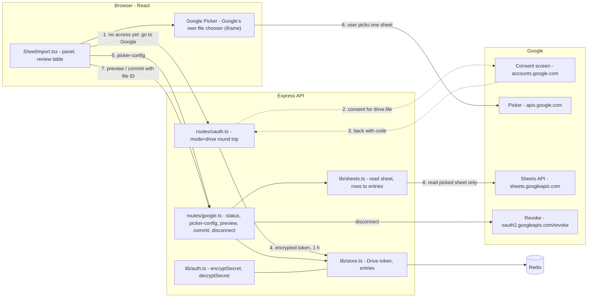
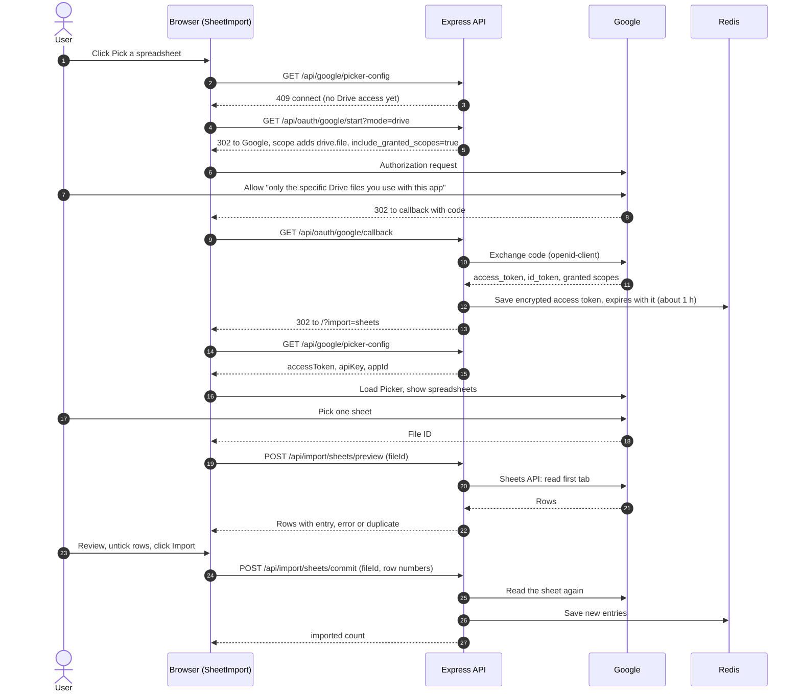
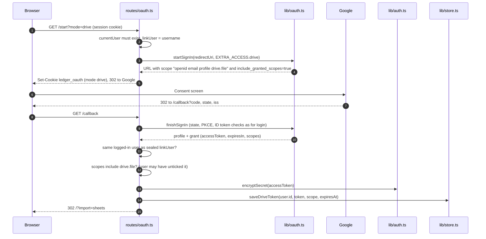
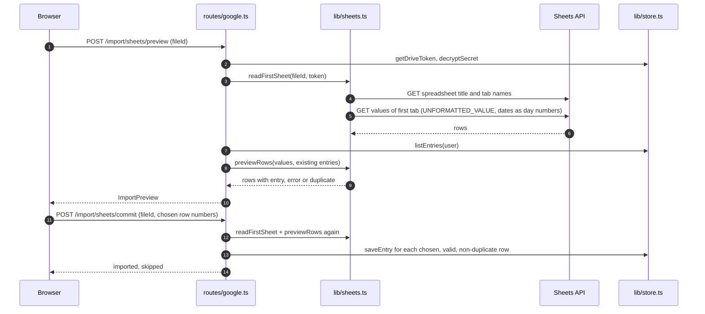

# Import from Google Sheets: design notes

How a logged-in user lets the ledger read **one Google Sheet they pick**, and turns its rows into ledger entries. This is the **authorization** side of OAuth: login (see [oauth-google-signin.md](oauth-google-signin.md)) answers "who is this?", while this feature asks Google "may the ledger open this person's file?".

| Permission | Picked by | Access kept | New settings | Data kept by the ledger |
|---|---|---|---|---|
| `drive.file`: only files the user picks (non-sensitive scope) | The user, in Google's own Picker | About 1 hour, encrypted, no refresh token | `GOOGLE_API_KEY`, `GOOGLE_PROJECT_NUMBER` | Only the rows the user imports, as normal entries |

> The diagrams are Mermaid. Open the preview with **Markdown Preview Enhanced** (`Ctrl+K V`) in VS Code, or view the file on GitHub.

## Contents

1. [Overview](#1-overview)
2. [HLD: components](#2-hld-components)
3. [HLD: end-to-end flow](#3-hld-end-to-end-flow)
4. [LLD: endpoints](#4-lld-endpoints)
5. [LLD: asking Google for Drive access](#5-lld-asking-google-for-drive-access)
6. [LLD: picking a sheet in the browser](#6-lld-picking-a-sheet-in-the-browser)
7. [LLD: preview and import](#7-lld-preview-and-import)
8. [LLD: sheet format and row rules](#8-lld-sheet-format-and-row-rules)
9. [LLD: token storage](#9-lld-token-storage)
10. [Security and privacy](#10-security-and-privacy)
11. [Setup and testing](#11-setup-and-testing)

---

## 1. Overview

Google gives two kinds of consent:

| Kind | User approves | Granularity |
|---|---|---|
| **Scope consent** (Google's consent screen) | A *type* of data, e.g. "See your contacts" | All items of that type |
| **Picker consent** (Google's file picker) | *Specific files* the user selects | Per file |

This feature uses both, in the narrowest form Google offers for documents:
- The consent screen asks for `drive.file`, described as "See, edit, create and delete only the specific Google Drive files you use with this app".
- Google's **Picker** then lets the user choose one spreadsheet. Only that file becomes visible to the ledger.

The rest of Drive stays invisible, and a sheet the user didn't pick returns *not found* from Google's API.

The permission is asked for **only when the user clicks "Pick a spreadsheet"** (incremental authorization), never at login. Login still asks only for `openid email profile`.

---

## 2. HLD: components



| Component | Responsibility | File |
|---|---|---|
| Import panel | Shows the panel only when the server is set up; starts the flow; loads Google's Picker script on demand; shows the review table; sends the chosen row numbers | `client/src/components/SheetImport.tsx` |
| Ledger page | Opens the picker straight away after returning from Google (`?import=sheets`); reloads entries after an import | `client/src/pages/LedgerPage.tsx:47, 326` |
| OAuth routes | `mode=drive`: logged-in users only, adds `drive.file` to the request, stores the granted token | `server/routes/oauth.ts:15-20, 43-47, 101-113` |
| OAuth module | Extra scopes and params for the authorization URL; reports what Google actually granted | `server/lib/oauth.ts:81-88, 98, 122-126, 166-170` |
| Import routes | Status, Picker settings, preview, commit, disconnect; turns Google errors into actions | `server/routes/google.ts` |
| Sheet module | Reads the first tab of the picked sheet; maps columns; validates rows; finds duplicates | `server/lib/sheets.ts` |
| Auth module | AES-256-GCM encryption for the stored token | `server/lib/auth.ts:100-121` |
| Store | Drive token with an expiry, under `u:<id>:google-drive` | `server/lib/store.ts:57-64, 149-167` |

---

## 3. HLD: end-to-end flow



**Later imports within the hour** start at step 14: the token is still stored, so the Picker opens immediately.

**After the hour** the flow repeats from step 3. Google remembers the grant, so it normally redirects straight back without showing the consent screen.

---

## 4. LLD: endpoints

| Route | Auth | Does | Returns | Source |
|---|---|---|---|---|
| `GET /api/oauth/google/start?mode=drive` | Logged in | Seals the user and mode into `ledger_oauth`; asks for `drive.file` | 302 to Google | `routes/oauth.ts:43-58` |
| `GET /api/oauth/google/callback` (mode `drive`) | Logged in, same user | Checks the scope was granted; stores the encrypted token | 302 to `/?import=sheets`, or `/?error=…` | `routes/oauth.ts:101-113` |
| `GET /api/google/status` | Logged in | Is the feature set up? Is there a valid Drive token? | `{ configured, connected }` | `routes/google.ts:43` |
| `GET /api/google/picker-config` | Logged in | Gives the browser what the Picker needs | `{ accessToken, apiKey, appId, expiresAt }`, `409 { connect }` or `503` | `routes/google.ts:49` |
| `POST /api/import/sheets/preview` | Logged in | Reads the picked sheet; validates every row | `ImportPreview` (`shared/types.ts`) | `routes/google.ts:58` |
| `POST /api/import/sheets/commit` | Logged in | Re-reads the sheet; saves the chosen valid, non-duplicate rows | `{ imported, skipped }` | `routes/google.ts:77` |
| `POST /api/google/disconnect` | Logged in | Revokes the token at Google; deletes it | `{ ok: true }` | `routes/google.ts:109` |

**Error answers the page acts on:**

| Answer | Cause | What the page does |
|---|---|---|
| `409 { connect: true }` | No token, token about to expire, or Google said 401 | Goes to `/api/oauth/google/start?mode=drive` |
| `400` "can't open that spreadsheet" | Google said 403/404: not a picked file | Shows the message; the user picks again |
| `400` "isn't a Google Sheet" | Google said 400: e.g. an Excel file stored in Drive | Shows how to save it as a Google Sheet |
| `400` other | Bad file ID, empty sheet, missing columns, too many rows, no rows ticked | Shows the message |
| `503` | `GOOGLE_API_KEY` or `GOOGLE_PROJECT_NUMBER` not set | The panel isn't shown at all (`status.configured` is false) |

---

## 5. LLD: asking Google for Drive access

The existing sign-in round trip (state, nonce, PKCE, signed `ledger_oauth` cookie, `openid-client`) is reused with a new mode.



```ts
// server/routes/oauth.ts: only "drive" asks for more than sign-in
const EXTRA_ACCESS = {
  drive: { scopes: [DRIVE_FILE_SCOPE], params: { include_granted_scopes: "true" } },
};
```

**Design points:**
- **No account linking or sign-in happens in this mode.** Any Google account the user chooses is fine. It only decides whose Drive they pick from.
- **`include_granted_scopes=true`** keeps earlier permissions in the same grant (incremental authorization).
- **No `access_type=offline`**, so Google returns no refresh token and the ledger has nothing long-lived to protect.
- **Errors in this mode go back to the ledger** (`/?error=…`), not the login page, because the user is still logged in.

---

## 6. LLD: picking a sheet in the browser

`client/src/components/SheetImport.tsx`

```ts
// Google's Picker script is loaded only when someone imports
s.src = "https://apis.google.com/js/api.js";
gapi.load("picker", { callback });

new google.picker.PickerBuilder()
  .addView(new google.picker.DocsView(google.picker.ViewId.SPREADSHEETS))
  .setOAuthToken(cfg.accessToken)   // drive.file token from /api/google/picker-config
  .setDeveloperKey(cfg.apiKey)      // GOOGLE_API_KEY
  .setAppId(cfg.appId)              // GOOGLE_PROJECT_NUMBER
  .setCallback(data => /* PICKED → file ID, CANCEL → null */)
  .build()
  .setVisible(true);
```

| Value | Why the Picker needs it |
|---|---|
| `accessToken` | Shows *this user's* Drive. Short-lived and only `drive.file`. |
| `apiKey` | Identifies the app to the Picker API. It's a public browser key, so restrict it to the Picker API and to the app's websites. |
| `appId` (project number) | **Required for `drive.file`.** It tells Google which app the picked file is being granted to, so the server's Sheets API calls are allowed for that file. |

This is the first time a Google access token reaches the page. That's how Google designed the Picker. The token is narrow (picked files only) and short-lived, and the session cookie that guards the endpoint is httpOnly.

---

## 7. LLD: preview and import



**Why read the sheet twice?** The commit trusts nothing from the browser except *which row numbers* to include. Every saved entry comes from Google's data and passes `validateEntry` on the server. A changed request can't insert made-up entries.

**Name spelling:** like adding by hand, an imported "bilal" is saved as "Bilal" if Bilal is already in the ledger (`personKey` match).

---

## 8. LLD: sheet format and row rules

`server/lib/sheets.ts`

**Header row:** the first non-empty row. Names are matched without regard to case.

| Field | Accepted headers | Required |
|---|---|---|
| date | Date | Yes |
| person | Person, Name | Yes |
| kind | What happened, Type, Kind | Yes |
| amount | Amount (Rs), Amount | Yes |
| effect | Effect on balance (Rs), Effect on balance | No (only to settle "Repaid") |
| note | Note, Notes, Description | No |

The ledger's own **Download CSV** uses exactly these headers, so an export opened in Google Sheets imports back without changes.

| Cell | Accepted | Becomes |
|---|---|---|
| Date | A real date cell (Sheets day number), `YYYY-MM-DD`, `DD/MM/YYYY` | `YYYY-MM-DD`; impossible dates like 31/02 are rejected |
| What happened | `I lent money`, `I borrowed money`, `They paid me back`, `I paid them back`, `Lent`, `Borrowed`, `lent` / `borrowed` / `received` / `paid` | The entry kind |
| What happened = `Repaid` | Needs the Effect column: negative → *They paid me back*, positive → *I paid them back* | Otherwise an error explaining what to write |
| Amount | Numbers, or text like `Rs 1,200` | Whole rupees above zero |
| Person, Note | Same rules as the entry form (60 / 200 characters) | Via `validateEntry` |

**Other rules:**
- **Blank lines** are skipped. Row numbers in the review table match the row numbers in Google Sheets.
- **Duplicates:** same date, person (any case), kind, amount and note (any case). They're counted, so two identical sheet rows against one existing entry leave one to import. Importing the same sheet twice imports nothing the second time.
- **Limit:** 1,000 data rows per import.
- **Only the first tab** is read.
- **Only native Google Sheets.** The Picker lists only `application/vnd.google-apps.spreadsheet` files, because the Sheets API can't read Excel (`.xlsx`) files stored in Drive. Convert those with File → Save as Google Sheets first.

---

## 9. LLD: token storage

| Property | Value |
|---|---|
| Redis key | `u:<user id>:google-drive` |
| Stored | `{ token, scope, expiresAt }`; `token` is AES-256-GCM encrypted (`iv.tag.ciphertext`, base64url) |
| Encryption key | HKDF-SHA256 from `SESSION_SECRET` (or the generated secret in Redis); no extra setting |
| Expiry | The Redis key expires when the Google token does (`SET … EX`) |
| Treated as missing | Less than a minute left, decryption fails, or Google answers 401 (then it's deleted) |
| Deleted | Disconnect (after revoking at Google), expiry, or a 401 |

**Why encrypted, not just signed?** Signing (used for cookies) only stops tampering. Anyone who could read the database could still *use* a signed token. Encryption makes a copied database row useless without the server's secret.

**Why no refresh token?** A refresh token would let the ledger open the user's picked files at any time, for months. Importing only happens while the user is looking at the page, so a 1-hour token is enough. Google re-approves an existing grant with a quick redirect when it runs out.

---

## 10. Security and privacy

| Risk | Control | Where |
|---|---|---|
| App reads more of Drive than needed | `drive.file`: only files picked in Google's Picker; others return 404 | Google, `routes/google.ts:31-41` |
| Asking for Drive at login scares users / grants too early | Asked only on "Pick a spreadsheet" (incremental authorization) | `routes/oauth.ts:18-20` |
| User unticks Drive on the consent screen | Granted scopes checked; a clear message if `drive.file` is missing | `routes/oauth.ts:104-106` |
| Someone else's browser finishing the Drive round trip | Same `state`/PKCE/nonce checks as login, plus the logged-in user must equal the sealed `linkUser` | `routes/oauth.ts:101-103` |
| Stolen database row | Token encrypted with AES-256-GCM; expires within the hour | `lib/auth.ts:100-121`, `lib/store.ts:149-167` |
| Forged import data | Commit re-reads the sheet from Google; every row goes through `validateEntry` | `routes/google.ts:77-106` |
| Path tricks in the file ID | File ID must match `^[\w-]{10,200}$` and is URL-encoded | `routes/google.ts:28`, `lib/sheets.ts:25` |
| Access left open | Disconnect revokes at Google and deletes the token; users can also remove it in their Google Account | `routes/google.ts:109-122` |
| Formula text in sheet cells | Imported values are stored as plain text; the CSV export already guards against formulas | `routes/entries.ts:43-47` |

The privacy page (`client/src/pages/PrivacyPage.tsx`) explains what is read, what is kept and how to revoke access, as Google's user-data policy requires.

---

## 11. Setup and testing

**Google Cloud** (same project as sign-in): enable the Drive, Sheets and Picker APIs; create a browser API key restricted to the Picker API and the app's websites (`GOOGLE_API_KEY`); copy the project number (`GOOGLE_PROJECT_NUMBER`); add the `drive.file` scope under Google Auth Platform → Data Access. Full steps are in the [README](../README.md).

**Manual test checklist:**
1. The first "Pick a spreadsheet" shows Google's consent screen listing only *specific Drive files*. Then the Picker shows your spreadsheets.
2. **Round trip:** Download CSV → upload to Google Sheets → import into another account. The balances should match.
3. A sheet with bad rows shows a reason for each one, and only ticked valid rows are imported.
4. Importing the same sheet again shows every row as *already in your ledger*.
5. Within the hour, "Pick a spreadsheet" opens the Picker straight away. After the hour (or after deleting the Redis key), it goes through Google again without the consent screen.
6. **Disconnect Google Drive:** the next pick shows the consent screen again, and the app disappears from Google Account → third-party connections.
7. Login, sign-up and Connect still ask only for `openid email profile`.
