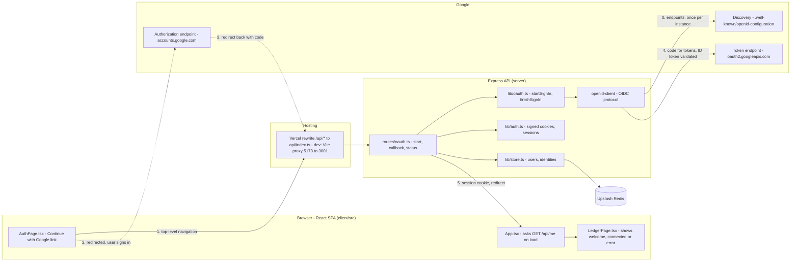
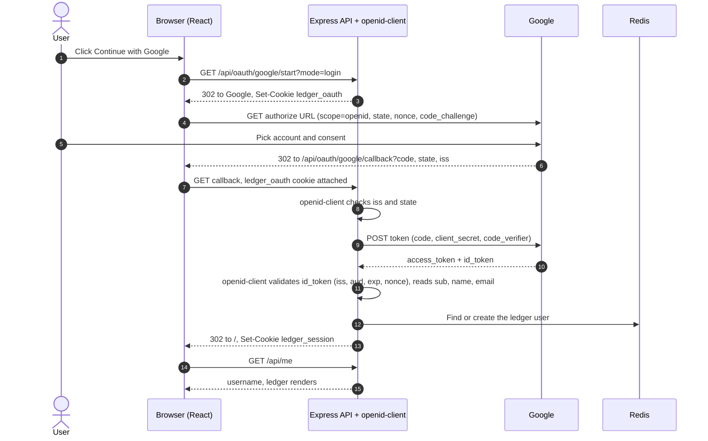
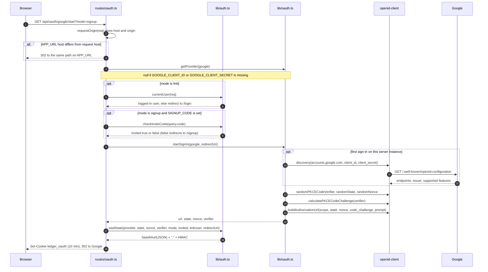
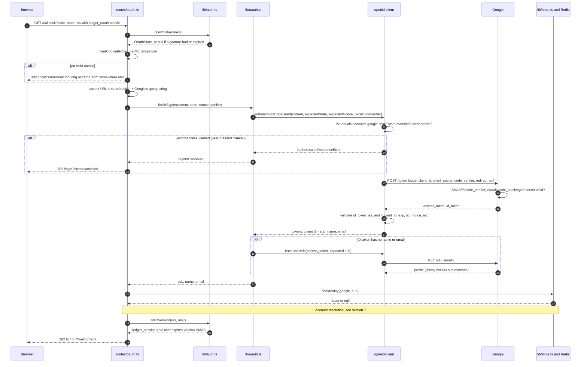
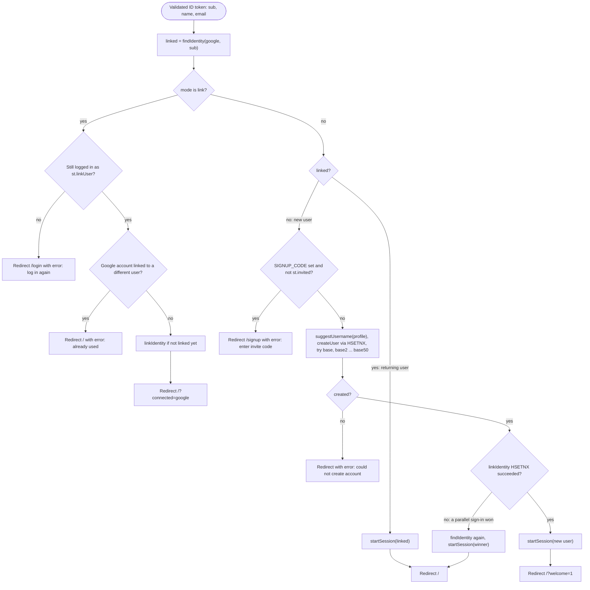

# Continue with Google: design notes

How the app proves who someone is with Google, then switches to its own session cookie. This document covers the **high-level design** (what talks to what) and the **low-level design** (every function, cookie, Redis key and check). File references point into `client/` and `server/`.

| Protocol | Library | Scopes | Identity key | After login | Storage |
|---|---|---|---|---|---|
| OpenID Connect (OAuth 2.0 authorization code + PKCE S256 + nonce) | [`openid-client`](https://github.com/panva/openid-client) v6 | `openid email profile` | Google `sub`, never email | App's own HMAC cookie, 30 days | Upstash Redis (in-memory in dev) |

> The diagrams are Mermaid. GitHub renders them as-is. In VS Code, open the preview with **Markdown Preview Enhanced** (`Ctrl+K V`).

## Contents

1. [Overview](#1-overview)
2. [HLD: components](#2-hld-components-and-boundaries)
3. [HLD: end-to-end flow](#3-hld-end-to-end-sequence)
4. [LLD: endpoints](#4-lld-endpoints-involved)
5. [LLD: start handler](#5-lld-start-handler)
6. [LLD: callback handler](#6-lld-callback-handler)
7. [LLD: account resolution](#7-lld-account-resolution)
8. [LLD: cookies, tokens and Redis keys](#8-lld-cookies-tokens-and-redis-keys)
9. [Security controls](#9-security-controls)
10. [Observations](#10-observations)

---

## 1. Overview

The browser never handles a Google token. Clicking the button is an ordinary link to the Express server. The server asks `openid-client` to create a random `state`, a `nonce` and a PKCE pair, and to build Google's sign-in URL. It keeps those values in a short-lived signed cookie and redirects the browser to Google.

Google sends the browser back with a one-time `code`. The server hands the callback URL to `openid-client`, which:
- checks the issuer and `state`
- exchanges the code (with the client secret and PKCE verifier) for tokens
- validates the **ID token**: issuer, audience = our client ID, expiry and `nonce`

The ID token's `sub` is Google's permanent ID for the person. It is mapped to a local ledger user in Redis, and the server sets the same `ledger_session` cookie that password login uses. From then on, Google plays no further part.

### What the library does and what the app does

| `openid-client` (protocol) | The app (`server/lib/oauth.ts`, `server/routes/oauth.ts`) |
|---|---|
| Discovers Google's endpoints from `/.well-known/openid-configuration` | Says which provider, client ID, secret and scopes to use |
| Creates `state`, `nonce`, PKCE verifier and challenge | Stores them between the two requests (signed `ledger_oauth` cookie) |
| Builds the authorization URL | Decides the mode (login / sign-up / link), invite code, `APP_URL` host |
| Validates the callback: `iss`, `state`, `error` | Rebuilds the exact callback URL behind Vercel's proxy |
| Exchanges the code at the token endpoint | Maps `sub` to a ledger user, creates users, links accounts |
| Validates the ID token claims (`iss`, `aud`, `exp`, `iat`, `nonce`, `azp`) | Starts the app's own session (`ledger_session`) |
| Calls UserInfo if needed (checks the `sub` matches) | Turns errors into friendly messages |

---

## 2. HLD: components and boundaries



Solid arrows are server-side calls. Dotted arrows are browser redirects (front channel). Only the one-time `code` passes through the browser; the tokens stay on the back channel between Express and Google.

| Component | Responsibility in this flow | Files |
|---|---|---|
| React client | Shows the button only when the server says Google is configured (`GET /api/auth/config`). The button is a plain `<a href>` because the whole page must leave for Google; a `fetch()` cannot follow a cross-site login. After return it asks `/api/me` because it cannot read the httpOnly cookie itself. | `client/src/pages/AuthPage.tsx`, `client/src/App.tsx`, `client/src/pages/LedgerPage.tsx` |
| Hosting layer | Prod: Vercel rewrites every `/api/*` to one serverless function that is the Express app. Dev: Vite on 5173 proxies `/api` to Express on 3001, so the browser sees a single origin either way and cookies just work. | `vercel.json`, `api/index.ts`, `vite.config.ts` |
| OAuth routes | Orchestration: validate the mode, set and clear the state cookie, decide the final redirect. | `server/routes/oauth.ts` |
| OAuth adapter | Provider config and two functions, `startSignIn()` and `finishSignIn()`, that wrap the library. Caches the discovered configuration. Knows nothing about cookies or users. | `server/lib/oauth.ts` |
| `openid-client` | All OpenID Connect protocol work: discovery, random values, URL building, response and token validation, code exchange. ESM-only, so it is loaded with `import()`. | `node_modules/openid-client` |
| Auth library | HMAC signing with `SESSION_SECRET`, sealing and opening the OAuth state cookie, minting and verifying session tokens. | `server/lib/auth.ts` |
| Store | Two Redis hashes: `users` and `identities`. Uses `HSETNX` so concurrent sign-ups cannot both claim a name or a Google account. | `server/lib/store.ts` |
| Google | Publishes its configuration, authenticates the person, shows the account picker (`prompt=select_account`), issues the code, verifies PKCE and the client secret, and returns the tokens. | external |

---

## 3. HLD: end-to-end sequence



Steps 2 to 7 are full-page navigations; the React app is unloaded while the user is on Google.

**Where OpenID Connect comes in:** `scope=openid` in step 4 turns the request into a login. Google authenticates the person in step 5. The `id_token` arrives in step 10, and step 11 is where the app learns **who** the user is (`sub`).

1. **Button click is a link** (browser): `href="/api/oauth/google/start?mode=login"`, or `mode=signup&code=INVITE` on the sign-up page. See `AuthPage.tsx:59-66`.
2. **Server prepares the trip** (Express): the library creates `state`, `nonce` and a PKCE pair and builds Google's URL. The app seals the values into the `ledger_oauth` cookie and redirects.
3. **Google authenticates** (Google): account picker and consent screen. Your app never sees the Google password.
4. **Callback validates and exchanges** (Express + library): checks `iss` and `state`, swaps the code for tokens on the back channel, and validates the ID token.
5. **Maps Google to a ledger user** (Redis): looks up `identities["google:<sub>"]`. Signs in, links, or creates a user.
6. **App reloads signed in** (browser): `App.tsx` calls `/api/me` and routes to the ledger. `LedgerPage` shows any `?welcome`, `?connected` or `?error` message.

---

## 4. LLD: endpoints involved

| Route | Called by | Does | Returns | Source |
|---|---|---|---|---|
| `GET /api/auth/config` | AuthPage on mount | Lists providers whose client ID and secret are both set; says whether an invite code is needed. | JSON `{providers, needsCode, hasDatabase}` | `routes/auth.ts:13` |
| `GET /api/oauth/:provider/start` | Browser navigation | Validates mode, invite and link session; asks the library for state, nonce, PKCE and the Google URL; seals the state cookie. | 302 to Google + `ledger_oauth` | `routes/oauth.ts:16-58` |
| `GET /api/oauth/:provider/callback` | Google's redirect | Opens the state cookie, lets the library validate and exchange, resolves the account, starts the session. | 302 to `/`, `/?welcome=1`, `/?connected=google` or `/login?error=…` | `routes/oauth.ts:61-126` |
| `GET /api/oauth/status` | LedgerPage settings | Shows which providers are linked and whether the user has a password. | JSON `{providers, connected, hasPassword}` | `routes/oauth.ts:128-134` |
| `GET /api/me` | App.tsx on load | Reads `ledger_session` and returns the user, or 401. | JSON `{username}` | `routes/auth.ts:17` |

| mode | Entered from | Pre-condition checked in start | Outcome in callback |
|---|---|---|---|
| `login` | /login page (default) | None | Signs in an existing link. Creates an account only if no invite code is configured. |
| `signup` | /signup page | If `SIGNUP_CODE` is set, the code must match; `invited=true` is sealed in the cookie | Signs in if already linked, otherwise creates a password-less user and redirects to `/?welcome=1`. |
| `link` | Connect button in the ledger (`LedgerPage.tsx:332`) | Must already be logged in; the username is sealed as `linkUser` | Attaches Google to the current account, then redirects to `/?connected=google`. |

---

## 5. LLD: start handler

Source: `server/routes/oauth.ts:16-58` and `startSignIn()` at `server/lib/oauth.ts:89-106`



Only the `challenge` goes to Google; the `verifier` stays inside the signed cookie until the callback. If discovery fails (for example, Google can't be reached), the user sees "Couldn't reach Google" and the next attempt retries it.

### The code

```ts
// server/lib/oauth.ts
export async function startSignIn(key: string, redirectUri: string): Promise<SignInStart> {
  const client = await oidc();                     // import("openid-client"), loaded once
  const config = await providerConfig(key);        // discovery, cached per server instance
  const verifier = client.randomPKCECodeVerifier();
  const state = client.randomState();
  const nonce = client.randomNonce();
  const url = client.buildAuthorizationUrl(config, {
    redirect_uri: redirectUri,
    scope: "openid email profile",
    state,
    nonce,
    code_challenge: await client.calculatePKCECodeChallenge(verifier),
    code_challenge_method: "S256",
    prompt: "select_account",
  });
  return { url: url.href, state, nonce, verifier };
}
```

### The URL sent to Google

```text
https://accounts.google.com/o/oauth2/v2/auth
  ?redirect_uri=https://APP/api/oauth/google/callback   (must match Google Cloud exactly)
  &scope=openid email profile
  &state=<random>
  &nonce=<random>                     ← new: ties the ID token to this sign-in
  &code_challenge=<SHA256(verifier)>
  &code_challenge_method=S256
  &prompt=select_account
  &client_id=GOOGLE_CLIENT_ID
  &response_type=code
```

### Why the APP_URL redirect exists

Vercel gives every deployment extra hostnames (preview URLs). If sign-in started on one of those, two things would break:

- Google would reject the unregistered `redirect_uri`.
- The `ledger_oauth` cookie would be set on a different host from the one the callback arrives on.

Lines 21-26 bounce the request to the canonical `APP_URL` host first. `app.set("trust proxy", true)` in `server/app.ts:15` lets `requestOrigin()` read the real host and protocol behind Vercel's proxy.

---

## 6. LLD: callback handler

Source: `server/routes/oauth.ts:61-126` and `finishSignIn()` at `server/lib/oauth.ts:116-149`



Any other failure (state mismatch, wrong issuer, a bad code, an invalid ID token) is logged server-side with the library's reason, and the user sees a generic "Couldn't sign in with Google" message.

### The code

```ts
// server/routes/oauth.ts: rebuild the exact address Google redirected to
const current = new URL(st.redirectUri);
current.search = req.originalUrl.split("?")[1] || "";
prof = await finishSignIn(provider, current, { state: st.state, nonce: st.nonce, verifier: st.verifier });

// server/lib/oauth.ts
tokens = await client.authorizationCodeGrant(config, currentUrl, {
  expectedState: checks.state,
  expectedNonce: checks.nonce,
  pkceCodeVerifier: checks.verifier,
  idTokenExpected: true,
});
const claims = tokens.claims();   // the validated ID token: sub, name, email, ...
```

**Why rebuild the URL?** The library uses the callback URL in two ways. It reads `code`, `state` and `iss` from the query, and it sends the URL *without* the query as `redirect_uri` in the token request. Google requires that `redirect_uri` to match the one in the sign-in URL byte for byte. Behind Vercel's proxy, `req.url` alone is only a path, so the app starts from the sealed `redirectUri` and adds Google's query string.

### What the library sends to the token endpoint (back channel)

```text
POST https://oauth2.googleapis.com/token
Content-Type: application/x-www-form-urlencoded

client_id=…
client_secret=…                   proves the request comes from your server (client_secret_post)
code=<from the callback URL>
code_verifier=<from ledger_oauth> proves it is the same flow (PKCE)
redirect_uri=<the callback URL without its query>
grant_type=authorization_code
```

### Order of checks

1. **The app** opens and clears the cookie first (line 64), so a state can never be reused, even on an error path.
2. **The library** checks `iss`, then `state`, and only then looks at Google's `?error`. A forged callback can't trigger anything, not even a "cancelled" message.
3. **The library** exchanges the code, then validates the ID token, and only then returns `sub`.

---

## 7. LLD: account resolution

Source: `server/routes/oauth.ts:90-125` (unchanged by the library switch)



New Google users get `salt: null, hash: null` (no password) and `via: "google"`. The username comes from the email's local part, e.g. `bilal.ahmed@gmail.com` becomes `bilal.ahmed`.

---

## 8. LLD: cookies, tokens and Redis keys

| Attribute | `ledger_oauth` (in flight) | `ledger_session` (signed in) |
|---|---|---|
| Purpose | Carries state, nonce and PKCE verifier between start and callback, so the server needs no session store | Says who you are on every API call |
| Format | `base64url(JSON OAuthState).HMAC` | `v2.b64(username).expires.sessionVersion.HMAC` |
| Lifetime | 10 min (cookie `maxAge` and `exp` inside) | 30 days |
| Path | `/api/oauth` only | `/` |
| HttpOnly / Secure | Yes / in production and on Vercel | Yes / in production and on Vercel |
| SameSite | `Lax` | `Lax` |
| Removed | First thing in the callback, whatever the outcome | On logout, or invalidated when `sessionVersion` changes |
| Created in | `lib/auth.ts:115` `sealState` | `lib/auth.ts:44` `makeToken` |

> **Why SameSite=Lax and not Strict:** the callback is a cross-site navigation that starts at accounts.google.com. With `Strict` the browser would not send `ledger_oauth` on that request, so the state check would fail every time. `Lax` sends cookies on top-level GET navigations, and that is exactly what the callback is.

### OAuthState (sealed in `ledger_oauth`)

```ts
{
  provider:    "google",
  state:       "random, from client.randomState()",
  nonce:       "random, from client.randomNonce()",
  verifier:    "PKCE secret, from client.randomPKCECodeVerifier()",
  mode:        "login" | "signup" | "link",
  invited:     true | false,
  linkUser:    "username" | null,
  redirectUri: "https://APP/api/oauth/google/callback",
  exp:         now + 10 min
}
```

The cookie is signed but not encrypted. Anyone holding it could read the verifier, but httpOnly and the 10-minute single use keep it out of reach. The signature stops tampering. The library creates the values; the app decides where to keep them.

### Redis layout

```text
# hash "users": lowercase username to JSON
users["bilal.ahmed"] = { id, username, salt: null, hash: null, sessionVersion: 0, createdAt, via: "google" }

# hash "identities": provider:sub to username
identities["google:1098…"] = "bilal.ahmed"
```

Both writes use `HSETNX` (set if absent). This makes username claims and Google links atomic without a lock. A user can have a password and a Google link at the same time.

### Configuration

| Variable | Role in the flow |
|---|---|
| `GOOGLE_CLIENT_ID`, `GOOGLE_CLIENT_SECRET` | Both are required, or the button is hidden and the routes refuse the request. |
| `APP_URL` | Canonical origin: builds `redirect_uri` and pins the start route to one host. Dev default is `http://localhost:5173` (the Vite port, which proxies to Express). |
| `SESSION_SECRET` | HMAC key for both cookies. If unset, a random key is generated once and stored in Redis. |
| `SIGNUP_CODE` | Turns on invite-only mode for new Google accounts. |
| `OAUTH_TEST_MOCK_URL` | Local testing only: the issuer URL of a local OpenID Connect test server, used instead of Google (plain http allowed). Ignored when `VERCEL_ENV=production`. |

Node.js 20 or newer is required (`openid-client` v6 baseline; see `engines` in `package.json`).

---

## 9. Security controls

| Threat | Control | Where |
|---|---|---|
| Login CSRF (attacker makes you finish their sign-in) | Random `state` from the library, sealed in the cookie, checked by the library | `lib/oauth.ts:127-132` |
| Stolen or intercepted auth code | PKCE S256. The code is useless without the verifier, which never leaves the server-signed cookie. The client secret is also required. | `lib/oauth.ts:93-102, 127-132` |
| ID token replayed from another sign-in | `nonce` in the sign-in URL must match the `nonce` claim in the ID token | `lib/oauth.ts:95, 129` |
| Token issued to a different app | ID token `aud` must equal our client ID (and `azp` when present) | library, `authorizationCodeGrant` |
| Mix-up (a reply from a different provider) | `iss` in the callback must equal Google's issuer, because Google advertises `authorization_response_iss_parameter_supported` | library, `authorizationCodeGrant` |
| Expired or future-dated ID token | `exp` and `iat` checked | library, `authorizationCodeGrant` |
| Tampered state (e.g. editing `linkUser` or `invited`) | HMAC-SHA256 signature checked before the cookie is parsed | `lib/auth.ts:120-129` |
| Replay of an old callback | Cookie cleared on first use and expires after 10 min. Google codes are single-use. | `routes/oauth.ts:64` |
| Token leaking via the browser | The exchange is server-to-server; tokens are never stored or sent to the browser | `lib/oauth.ts:116-149` |
| Session theft via XSS | httpOnly cookies. React can only ask `/api/me`. | `lib/auth.ts:71-77` |
| Hijacking someone else's ledger in link mode | The session user must equal the sealed `linkUser`, and the Google account must not be linked elsewhere (`HSETNX`) | `routes/oauth.ts:93-101` |
| Account confusion via a changed email | Identity is keyed by Google's stable `sub`; email is only used to suggest a username | `store.ts:183-193` |
| Mock provider in production | Mock URL ignored when `VERCEL_ENV=production` | `lib/oauth.ts:43` |

**ID token signature:** by default `openid-client` does not verify the ID token's signature against Google's keys, because the token comes straight from Google's token endpoint over TLS. The OpenID Connect spec allows this, and the library documents it. To verify signatures as well (for non-repudiation), pass `execute: [client.enableNonRepudiationChecks]` to `discovery()`.

---

## 10. Observations

- **Orphan account on a race.** If two tabs finish the same first-time sign-in at once, the loser has already created a user in `users` before its `linkIdentity` fails. That password-less record stays behind and can never be logged into, and it reserves its username. This is rare and harmless, but it could be cleaned up by deleting the candidate user (`routes/oauth.ts:120-123`).
- **Edge of that same race.** If `linkIdentity` fails and the second `findIdentity` somehow returns null, the code falls through and signs in the unlinked new user.
- **`identitiesOf()` reads the whole `identities` hash** on every `/api/oauth/status` call and filters it in memory. This is fine for a small user base but is O(all users); a reverse index such as `u:<id>:identities` would make it O(1).
- **Discovery on cold start.** Each new serverless instance fetches Google's discovery document once, on its first sign-in (one extra request of roughly 100 ms). The result is cached for the life of the instance.
- **One error message for several failures.** A state mismatch, wrong issuer, bad code or invalid ID token all show "Couldn't sign in with Google". The exact reason is in the server log (`OAuth error: google … (unexpected "state" response parameter value)`).
- **Error messages travel in the query string** (`?error=…`) and are rendered by React as text, which escapes them, so there is no XSS. Someone could still craft a link that shows misleading text on the login page.
